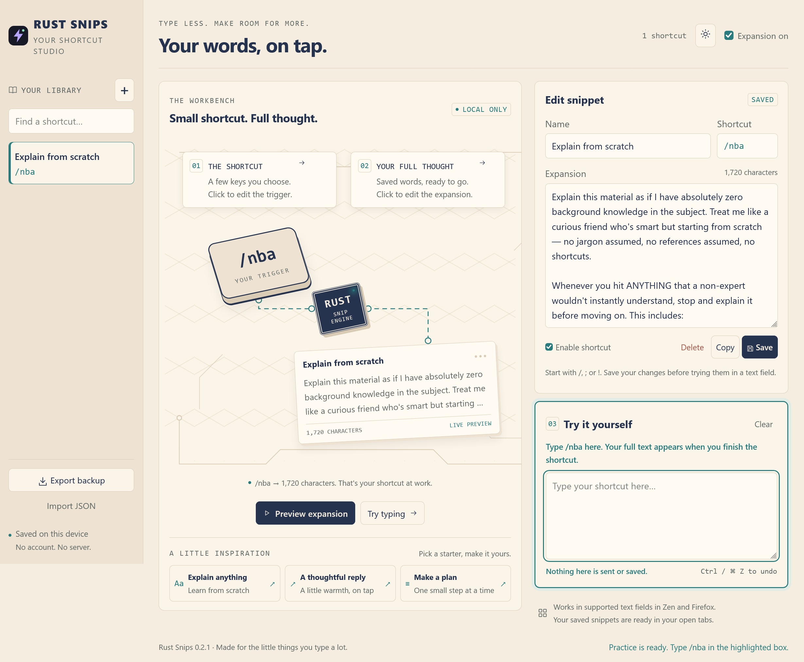

# Rust Snips

A small, local text expander for **Zen and Firefox**. Type a shortcut such as `/nba` and replace it with a full thought. A Rust matcher compiled to WebAssembly does the matching; a browser extension handles text fields, your snippet library, and the studio.

**Experimental release.** The available packages are unsigned and support temporary testing. A permanently installable, Mozilla-signed release is not available yet.



## Your words, on tap

- Add, edit, search, pause, and delete plain-text snippets.
- An interactive workbench: click the shortcut key to edit it, click the text callout to edit the expansion, or try typing in the practice box.
- A full-text preview popup, clear practice-box focus, readable text, starter snippets, and paper/dark themes.
- Export and import your library as JSON.
- Local browser storage, with no account, analytics, external API, server, or separate desktop app.
- No Rust crates, JavaScript packages, or remote fonts are required by the extension.

The included `/nba` example asks for an explanation from zero background knowledge. Starter cards also offer a thoughtful reply and a planning prompt; they become saved shortcuts only when you press **Save**.

## Try it in Zen or Firefox

1. Download the unsigned XPI from [Releases](https://github.com/vanamagautam24/rust-snips/releases), or build it below.
2. Open `about:debugging#/runtime/this-firefox`.
3. Choose **Load Temporary Add-on** and select the XPI. Alternatively, select `extension/manifest.json` from a built checkout.
4. Open **Extensions → Rust Snips → Open snippet editor**.
5. Type `/nba` in **Try it yourself**, or try a supported field on an ordinary website. Reload existing website tabs if needed after installation.

A temporary installation is removed when the browser restarts. **Export a JSON backup before removing it or restarting the browser.** Do not rely on temporary-extension storage as your only copy.

### Add a shortcut

Click **+**, enter a name, a trigger such as `/thanks`, and its expansion, then **Save**. Edits apply to open extension-enabled tabs without rebuilding. Shortcuts are case-sensitive, start with `/`, `;`, or `!`, and match at the start of a field, after whitespace, or after an opening bracket/quote. The current library limit is 200 snippets.

The board previews unsaved editor text; actual typing uses **saved, enabled** snippets. Use the native Undo command to restore the shortcut after expansion.

### Permanent installation

Normal release browsers require Mozilla signing. The project can use [unlisted signing](https://extensionworkshop.com/documentation/publish/signing-and-distribution-overview/) without a public store listing, or publish a listed add-on later. Signing requires the publisher's Mozilla account and uploads the package and requested build sources to Mozilla. Source packages include the reproducible Rust build inputs.

No signing submission has been made. This project does not disable browser signature verification. Publishing source on GitHub does not make the unsigned XPI permanently installable.

## Build

Use Rust **1.96.0** with the `wasm32-unknown-unknown` target, Node.js 22 or 24, Python 3, and Bash. Linux, macOS, and Windows through WSL/Git Bash are suitable build environments.

```sh
git clone https://github.com/vanamagautam24/rust-snips.git
cd rust-snips
rustup toolchain install 1.96.0 --profile minimal --target wasm32-unknown-unknown
bash build.sh
```

The script runs native Rust tests, compiles the matcher, runs integration tests against the actual WASM module, and produces:

- `extension/core.wasm`
- `dist/rust-snips-0.2.1-unsigned.xpi`
- `dist/rust-snips-0.2.1-source.zip`

Cargo runs offline once the compiler and target are installed. There are no Cargo dependencies or npm installation steps. JavaScript and CSS are packaged without minification. Extension ZIP entries have a fixed timestamp.

## How it works

| File                            | Purpose                                                 |
| ------------------------------- | ------------------------------------------------------- |
| `src/lib.rs`                    | Rust suffix/boundary matcher and small memory interface |
| `extension/engine.js`           | Loads the packaged WASM module and calls the matcher    |
| `extension/content.js`          | Detects eligible typing and inserts expansions          |
| `extension/schema.js`           | Validates and saves the snippet library                 |
| `extension/options.*`, `ui.css` | Interactive studio                                      |
| `extension/popup.*`             | Quick pause switch and editor access                    |
| `scripts/package.py`            | Extension and review-source archives                    |

The engine initializes when an eligible text field is focused, then reuses its instance in that frame. The extension's own studio warms it earlier for the practice box. A new page/frame initializes separately. The current WASM linear memory is about 1.13 MiB per initialized frame; this is **not** a measurement of total extension RAM or evidence of a performance advantage over another app.

## Compatibility and limits

The manifest targets Firefox 140+ and Firefox-based Zen releases. Version 0.2.1 was checked in Zen 1.23.4b and Firefox 158.0.1 on Windows. Regular text inputs, textareas, and standard contenteditable editors are supported. Password, OTP, and payment fields identified by input type/autocomplete are excluded, along with read-only and opted-out fields. Pasting does not trigger expansion.

This release handles plain-text shortcuts. It does not implement Text Blaze forms, dynamic commands, proprietary backup imports, or system-wide desktop expansion. Browser chrome, privileged pages, canvas editors, closed shadow roots, and every site's custom editor are not supported or guaranteed.

`bash build.sh` verifies boundaries, Unicode, longest matching, configuration, and WASM scratch-buffer clearing. The release was also checked with real typing in an isolated Zen profile, including the studio, saving, pause, theme persistence, Undo, protected fields, and narrow layouts. To reproduce browser checks, see [the checklist](docs/TESTING.md); automated build checks alone do not establish compatibility with every website.

## Privacy, contributing, and license

See [Privacy](PRIVACY.md), [Contributing](CONTRIBUTING.md), and the [MIT license](LICENSE). Your saved library and browser profile are not part of the repository or release packages.

The paper-and-ink visual direction was inspired by [Learn Arduino](https://learn-arduino-red.vercel.app/) by Dilum Sanjaya. Rust Snips' layout, vectors, styles, and interactions were written for this project; no recovered Arduino code or assets are included.
